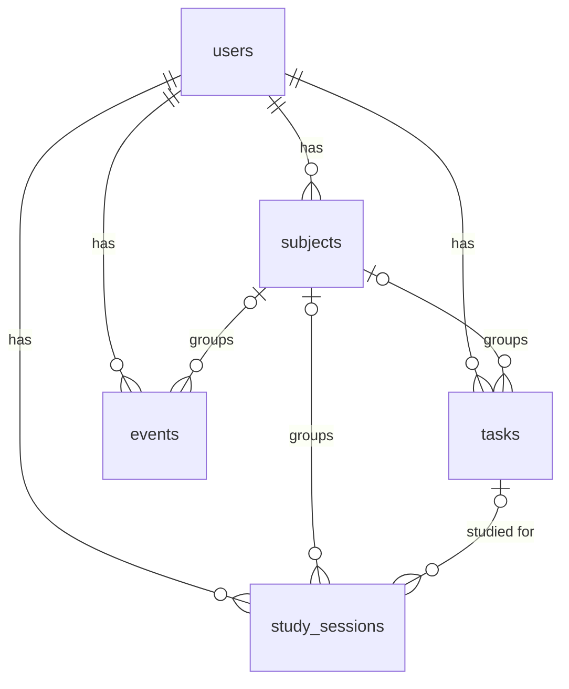

# Database

The database is **MySQL** (or MariaDB from XAMPP) and is named `studyplanner`.
We describe the tables in `prisma/schema.prisma`. Prisma turns that file into SQL
(the files in `prisma/migrations`) and gives us easy functions like `prisma.task.findMany()`.

## Tables

### Used by the app now

| Table | What it stores |
|-------|----------------|
| `users` | Accounts: name, email, password hash, settings |
| `tasks` | To-do items: title, notes, priority, status, due date |
| `subjects` | Subject names like "Web Development", one list per user |
| `events` | Calendar events: title, start, end, source |
| `study_sessions` | Study time: start, end, minutes, linked task |

### Ready for later features

| Table | Planned use |
|-------|-------------|
| `accounts` | Google login accounts (used by Auth.js) |
| `sessions`, `verification_tokens` | Required by Auth.js, not used with our cookie (JWT) login |
| `resources` | Resource Center: Drive files, Notion pages, uploads, links |
| `sync_states` | Google Calendar sync progress |

## How the tables connect



In words:

- One **user** has many tasks, subjects, events and study sessions.
- A **task**, **event** or **study session** can belong to one **subject** (optional).
- A **study session** can be linked to one **task** (optional).

## Main columns

**users**

| Column | Type | Notes |
|--------|------|-------|
| id | text (cuid) | Primary key |
| name | text | |
| email | text | Unique, so no two accounts share an email |
| passwordHash | text | bcrypt hash, never the real password |
| timezone, darkMode, autoSync... | various | Settings, planned |

**tasks**

| Column | Type | Notes |
|--------|------|-------|
| id | text (cuid) | Primary key |
| userId | text | Owner (foreign key to users) |
| subjectId | text or null | Foreign key to subjects |
| title | text | |
| notes | long text or null | |
| priority | `HIGH`, `MED`, `LOW` | Default `MED` |
| status | `TODO`, `DONE` | Default `TODO` |
| dueAt | date or null | |
| completedAt | date or null | Set when marked done |

**events**

| Column | Type | Notes |
|--------|------|-------|
| id, userId, subjectId | text | Same idea as tasks |
| title, description | text | |
| startAt, endAt | date | |
| source | `LOCAL` or `GCAL` | `LOCAL` = made in this app |
| googleEventId, etag... | text or null | For Google sync later |

**study_sessions**

| Column | Type | Notes |
|--------|------|-------|
| id, userId, subjectId, taskId | text | |
| startedAt, endedAt | date | |
| durationMin | number | Minutes studied |

## What happens when something is deleted

| If you delete... | Then... |
|------------------|---------|
| a user | all their tasks, events, subjects and study sessions are deleted too (`Cascade`) |
| a task | its study sessions stay, but their `taskId` becomes empty (`SetNull`) |
| a subject | tasks and events stay, but their `subjectId` becomes empty (`SetNull`) |

## Migrations

A migration is a SQL file that changes the database. Ours are in `prisma/migrations`:

| Migration | What it did |
|-----------|-------------|
| `20261025004837_init` | Created all the tables |
| `20261025011939_add_password_hash` | Added the `passwordHash` column to `users` |

**Apply them** (first setup, or after pulling new changes):

```bash
npx prisma migrate deploy
```

**Change the design:** edit `prisma/schema.prisma`, then run

```bash
npx prisma migrate dev --name describe_the_change
```

This creates a new migration file and applies it.

**Look at the data:** run `npx prisma studio` to open a simple website where you can
browse and edit the tables.
